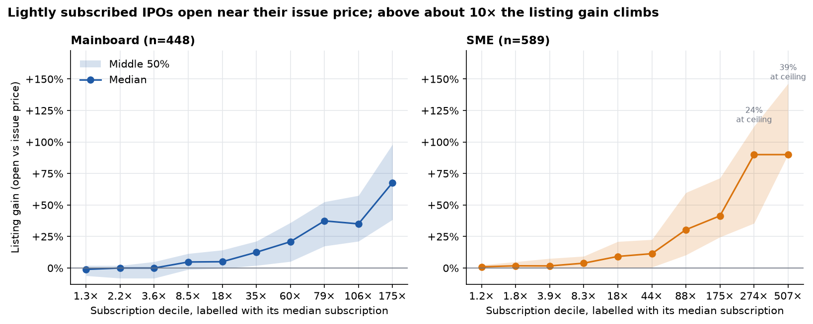
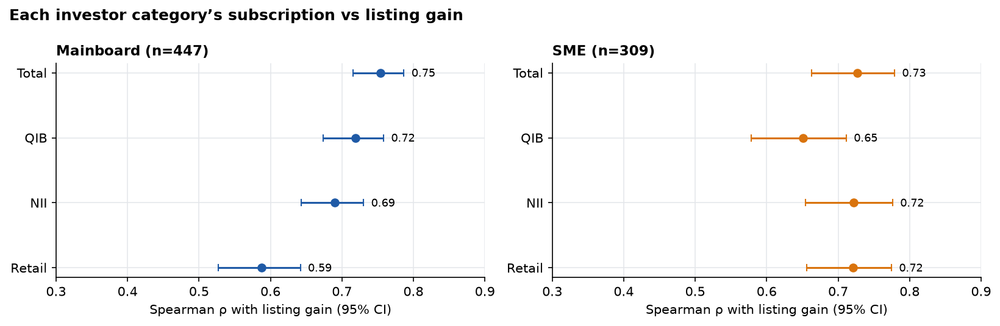
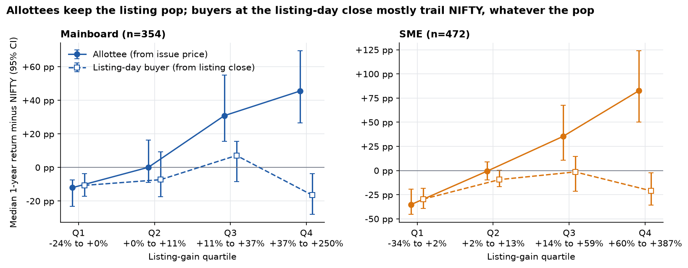
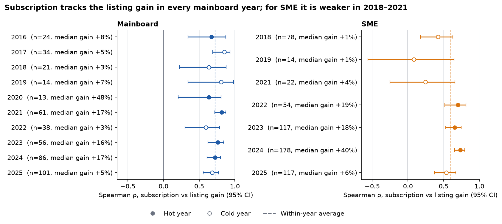
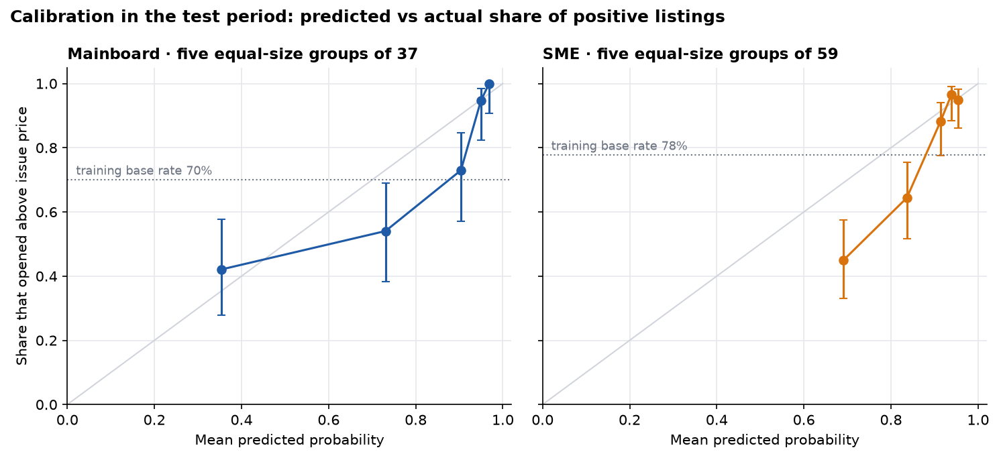

# NSE IPOs: does subscription demand predict returns?

Every mainboard and SME IPO listed on NSE from 2016 to January 2026 (1,143 IPOs), with subscription by investor category, the listing-day price and split-adjusted returns against NIFTY 50. It is built as a tested SQL warehouse, with analysis notebooks and a Streamlit dashboard on top.

- **Subscription strongly predicts the listing-day gain** in both segments (rank correlation 0.76 mainboard, 0.70 SME). Mainboard IPOs subscribed 3.6× or less opened at a median of −1%; those subscribed 79× or more opened at +45%.
- **It says nothing about the year after listing day.** Someone buying at the listing-day close typically trailed NIFTY over the next year (median −8 pp mainboard, −16 pp SME), however big the pop or the subscription.
- **A small model adds little.** Tested on 2024–25 listings, a logistic regression is no better than the subscription multiple alone for mainboard, and only slightly better for SME.

**Dashboard:** not deployed yet. Run it locally with `streamlit run app/streamlit_app.py` (see [Reproduce](#reproduce)). · **Plain-language summary:** [reports/findings.md](reports/findings.md)

## Pipeline

```
scrapers   NSE past issues · Chittorgarh subscription · Tickertape screener · NSE bhavcopy, NIFTY 50, corporate actions
   → data/raw/<snapshot>/        one folder per scrape, never overwritten (committed)
   → raw_* + seed_* tables       DuckDB; data/seeds/ holds reviewed matches, listings, exclusions and corporate actions
   → stg_*                       clean each source                                      sql_transformations/stg_*.sql
   → int_*                       listing day, price history (renames, splits, bonuses), matching, horizon returns
   → mart_ipo_analytics          one row per IPO, nothing dropped; + audit_join_funnel
   → checks                      22 rules in sql_checks/*.sql; any violation stops the run
   → exports                     data/mart/mart_ipo_analytics_<snapshot>.parquet / .csv, reports/join_funnel_<snapshot>.csv
   → notebooks/  ·  app/         analysis and dashboard read the exports only
```

| Where | What |
|---|---|
| [pipeline.py](pipeline.py) | Runs scrape → load → staging → matching and mart → checks → export |
| [notebooks/01_data_overview](notebooks/01_data_overview.ipynb) | Coverage and structural gaps, return distributions, base rates by year, why `return_since_issue_pct` can't be compared across years, survivorship |
| [notebooks/02_subscription_vs_returns](notebooks/02_subscription_vs_returns.ipynb) | The four research questions below, with bootstrap CIs, within-year checks, median regression and a verdict table |
| [notebooks/03_listing_gain_model](notebooks/03_listing_gain_model.ipynb) | One logistic regression per segment, time-split, against three baselines; ROC, calibration and a backtest with the allotment caveat |
| [app/](app/streamlit_app.py) | Dashboard pages: Overview, Explore (filters by segment, year, sector and issue size), IPO lookup (`?ticker=SYMBOL`), Findings |
| [src/](src/) | Data loading, statistics (`stats.py`), chart style, dashboard tables |
| [tests/](tests/) | Warehouse built from fixture files, statistics, price-file parsing and every dashboard page |

## Coverage

Snapshot 2026-02-15. Mainboard issues run from 2016, the start of the NSE past-issues feed; SME subscription figures effectively start in 2018.

| Step | Mainboard | SME | All |
|---|---:|---:|---:|
| Equity issues in the NSE feed | 467 | 703 | 1,170 |
| IPOs (excl. FPOs, withdrawn, partly-paid, follow-ons) | 457 | 697 | 1,154 |
| Listed on NSE = mart rows | 452 | 691 | 1,143 |
| With listing-day prices | 450 | 691 | 1,141 |
| With a subscription record | 450 | 660 | 1,110 |
| With subscription figures (the record has numbers) | 450 | 598 | 1,048 |
| With market data | 449 | 679 | 1,128 |
| With listing prices and subscription data | 448 | 660 | 1,108 |
| With a 1-year return (listed ≥ 1 year before the snapshot and still trading) | 356 | 573 | 929 |

**Listing day.** An IPO's listing day is its first trade in the NSE bhavcopy within 30 days of issue close. On that day the bhavcopy's previous close is the exchange's base price. It equals the issue price derived from the NSE feed for 99.6% of listings, which checks both the listing day and the issue price.

**Returns.** Every return is measured from the issue price and adjusted for bonuses and splits by following the security through renames and ISIN changes. Horizons (1m, 6m, 1y, 3y) are counted from the listing date. NIFTY 50 is measured over the same money-at-risk period, from issue close to the horizon. Adjusted returns match Yahoo Finance's split-adjusted prices on a sample of 18 IPOs with corporate actions.

**Matching.** IPOs are matched to subscription records on issue close date (±3 days) plus company-name similarity, and to Tickertape stocks mainly through their current NSE symbol. Cases the rules can't settle were reviewed by hand and recorded in `data/seeds/`.

## Data dictionary

All 84 mart columns, with type, source, definition and the dates each return runs between, are in **[docs/data_dictionary.md](docs/data_dictionary.md)**. The columns most analyses need:

| Column | Meaning |
|---|---|
| `segment` | `MAINBOARD` or `SME`; never pool them |
| `listing_gain_pct` | Listing-day open vs issue price, % |
| `subscription_total_x`, `_qib_x`, `_nii_x`, `_retail_x` | Times subscribed on the final day, overall and by category |
| `has_subscription_figures`, `has_qib_category` | Whether subscription numbers exist, and whether the issue had a QIB portion at all |
| `excess_return_1y_pct` | Allottee: issue price → price one year after listing, minus NIFTY 50 from issue close, pp |
| `aftermarket_excess_return_1y_pct` | Listing-day buyer: listing-day close → one year after listing, minus NIFTY 50 over the same period, pp |
| `listing_capped` | SME listing opened at NSE's +90% cap (from 2024-07-04) |

## Findings

Snapshot 2026-02-15; mainboard from 2016, SME from 2018 (1,037 IPOs with a listing price and subscription figures). Brackets are 95% bootstrap intervals; ρ is a Spearman rank correlation. Details and the full verdict table are in [notebook 02](notebooks/02_subscription_vs_returns.ipynb).

**1. Does subscription predict the listing-day gain? Yes, strongly.** ρ = 0.76 [0.72, 0.79] mainboard and 0.70 [0.65, 0.74] SME, and 0.72 / 0.60 within a single year, so it isn't just hot years against cold ones. Each doubling of subscription adds about 7 pp to the median listing gain after year and issue-size controls. For SME the top deciles sit at the +90% listing cap, so their gains are understated.



**2. Is QIB demand a stronger signal than retail? For mainboard, yes; for SME, no.** Mainboard ρ is 0.72 for QIB against 0.59 for retail (difference +0.13 [+0.07, +0.19]); QIB and NII can't be told apart. For SME issues with a QIB portion, almost all from 2023, QIB is the weakest of the three categories (−0.07 [−0.12, −0.03] against retail, borderline after adjusting for the number of tests).



**3. Do listing pops persist or fade? Neither, for anyone buying on listing day.** For a buyer at the listing-day close, neither the listing gain nor subscription ranks the next year's return over NIFTY (|ρ| ≤ 0.07). The typical buyer trailed NIFTY: −7.9 pp [−12.2, −0.4] mainboard (borderline after adjustment) and −15.8 pp [−23.2, −9.9] SME. Allottees kept the pop and beat NIFTY on median by +16.4 pp and +10.5 pp.



**4. Does it hold in hot and cold IPO years? Mainboard yes; SME is weaker in cold years.** Within-year ρ for mainboard is 0.74 in hot years and 0.70 in cold ones (difference +0.05 [−0.05, +0.15]). For SME it is 0.70 against 0.44 (+0.26 [+0.13, +0.40]), but three of the four cold SME years are 2018–2021, when the market was small, so the two can't be separated.



## Model

[Notebook 03](notebooks/03_listing_gain_model.ipynb) fits one logistic regression per segment to predict whether an IPO opens above its issue price. Inputs are log subscription by category, issue size and issue price. It is trained on listings to 2023 and tested on 2024 onwards (187 mainboard, 296 SME).

It ranks IPOs well (AUC 0.83 mainboard, 0.82 SME) and clearly beats the training base rate and the rule "subscribed more than 10×". For mainboard, though, it is no better than the subscription multiple alone (AUC 0.835 vs 0.831, difference +0.004 [−0.012, +0.020]). For SME, NII demand improves its probabilities slightly (Brier −0.006 [−0.012, −0.001]).

Its probabilities came out too optimistic for 2024–25 (mean forecast 87% vs 78% positive for SME). Subscription multiples rose while a given multiple listed positive less often, so it would need recalibrating on recent listings. A backtest is shown, but it isn't achievable: the most subscribed issues are the hardest to be allotted.



## Limitations

- **Survivorship.** No IPO is dropped, but prices stop when a stock stops trading on NSE (34 did, 30 of them SME). A horizon return is empty if the stock had no NSE trade in the 30 days before it: 11 of 940 due 1-year returns and 20 of 494 due 3-year returns. Tickertape lists only current stocks, so 15 IPOs have no sector or market data.
- **One snapshot.** Everything is as of 2026-02-15. Tickertape fields (sector, market cap, P/E, ROE, P/B) describe the company then, not at listing.
- **Coverage starts in 2016.** That is where NSE's past-issues feed begins. Chittorgarh has no SME subscription records for 2016 and lists most 2017 SME issues without numbers, so SME subscription analysis starts in 2018.
- **QIB data for SME is structural.** Fewer than 17% of SME issues had a QIB portion in any year to 2022, rising to 90% in 2025. SME QIB results describe 2023 onwards; `has_qib_category` separates "no QIB portion" from "unknown".
- **SME listing gains are truncated.** NSE caps an SME IPO's opening price at +90% from 2024-07-04 (43 IPOs at the cap). Before 26 Apr 2018 no SME listing opened above +20% (46 at exactly +20%); the data shows this, but no circular was found. The analysis uses medians, ranks and shares, not means.
- **Not a strategy.** Heavily subscribed issues are the hardest to be allotted, and final-day subscription is only partly known when an application has to be made.
- **Matching.** 1,093 of 1,110 subscription matches are exact (same normalised name and close date), 15 fuzzy and 2 manual. Market matches: 1,086 through the current NSE symbol, 19 by ticker and name similarity, 1 by name and 22 reviewed by hand.
- **Known gaps.**
  - IRCTC (2019) and AU Small Finance Bank (2017) have no subscription match.
  - CAMS, PROTEAN and NSDL listed on BSE only at IPO: CAMS and PROTEAN have no listing prices, and NSDL is not in the mart.
- **Returns exclude dividends,** as does the NIFTY 50 price index used as the benchmark.
- **Demergers aren't adjusted.** A large one shows up as an unexplained price gap (QUESS, SHANKARA), and returns across it are left empty.
- **Placeholder values.** Chittorgarh uses `9999` for a missing multiple; it is stored as unknown.
- **Many comparisons.** Notebook 02 reports 24 headline intervals, each also shown with a Bonferroni adjustment. The results called borderline above don't survive it clearly.

## Reproduce

Requires **Python 3.11**. The raw snapshots are committed, so the warehouse rebuilds without any scraping.

```bash
git clone https://github.com/snehilojha/IPO-performance.git && cd IPO-performance
python -m venv .venv
.venv\Scripts\activate          # Windows; use `source .venv/bin/activate` elsewhere
pip install -r requirements.txt

# Rebuild the warehouse from the committed snapshot (seconds; runs all 22 checks, rewrites data/mart/ and reports/)
python pipeline.py --snapshot 2026-02-15 --skip-scrape

# Dashboard (reads the exports only; app/requirements.txt is the smaller runtime set used for deployment)
streamlit run app/streamlit_app.py

# Tests and lint, as CI runs them
pytest
ruff check .

# Re-run a notebook and save its outputs (they read the latest export; set IPO_SNAPSHOT=YYYY-MM-DD to pick one)
jupyter nbconvert --to notebook --execute --inplace notebooks/01_data_overview.ipynb
jupyter nbconvert --to notebook --execute --inplace notebooks/02_subscription_vs_returns.ipynb   # ~2 minutes (bootstraps)
jupyter nbconvert --to notebook --execute --inplace notebooks/03_listing_gain_model.ipynb        # ~1 minute
```

The notebooks are the source files. Re-executing them on the same export gives identical outputs and charts, because the seeds are fixed.

**Scraping a new snapshot** (`python pipeline.py` scrapes into `data/raw/<today>/`, then `python -m scrapers.nse_price_scraper --snapshot <today>` adds prices) depends on the sources still answering. Checked 2026-09-14:

| Source | Status |
|---|---|
| NSE past issues API | Working |
| NSE bhavcopy, index close and corporate actions | Working. Daily files are cached in `data/cache/nse/`, which is not committed; a first run downloads about 320 MB. |
| Tickertape screener API | Working |
| Chittorgarh subscription reports | **Broken:** the API now answers "No params data found" for every year, so a fresh scrape fails at the subscription step |

## Next steps

- Deploy the dashboard on Streamlit Community Cloud (entrypoint `app/streamlit_app.py`, Python 3.11) and link it at the top.
- Update the Chittorgarh scraper for its current API, then take a fresh snapshot.
- Add seed matches for IRCTC and AU Small Finance Bank.
- Recalibrate the model on recent listings before reading its probabilities literally.
- *Stretch:*
  - grey market premium as a feature;
  - anchor-investor and promoter-holding data from offer documents;
  - port the SQL layers to dbt-duckdb.

The build history and every decision are in [docs/ROADMAP.md](docs/ROADMAP.md).

## Disclaimer

For educational purposes only. Not investment advice.
